# Repo Checker

[](https://github.com/Shuunen/repo-checker/blob/master/LICENSE)
[](https://codeclimate.com/github/Shuunen/repo-checker)
[](https://www.npmjs.com/package/repo-check)
[](https://www.npmjs.com/package/repo-check)
[](https://hits.sh/github.com/Shuunen/repo-checker/)

[](https://packagequality.com/#?package=repo-check)
[](https://bundlephobia.com/package/repo-check)
[](https://packagephobia.com/result?p=repo-check)


- [Repo Checker](#repo-checker)
  - [Cli mode](#cli-mode)
  - [UI mode](#ui-mode)
  - [Usage](#usage)
  - [Options](#options)
  - [Configuration](#configuration)
  - [Thanks](#thanks)

## Cli mode

Run `repo-check` :



## UI mode

Run `repo-check ui` :


## Usage

Run it in a folder of projects to check them all against your GitHub account, or inside one project to check only that one. It needs `git` and an authenticated [GitHub CLI](https://cli.github.com) (`gh auth login`), and the report changes nothing unless you add `--fix`, which applies the file fixes (a file you already changed gets the fix merged into your changes, and nothing is committed, `git diff` shows it). `repo-check ui` can fix things too, always after a confirmation that says what will happen.

```bash
npx repo-check
```

From a clone of this repository: `pnpm install` then `pnpm start --target=~/Projects`. To look at the dashboard without your own repos, `pnpm run build` then `pnpm demo` starts it on a fake account (see [demo/README.md](demo/README.md)).

`npx repo-check ui` (or `pnpm start:ui` from a clone) starts a local server on `127.0.0.1:4747` instead. Open the printed URL: the project list fills in as the scan streams, with filters, summary tiles and a Rescan button, and a click on a project opens its findings and git state, refreshed live while the page is open. Run inside one project, it opens straight on that project. Every action runs after a confirmation that says what will happen, and the server proves again, with a fresh fetch, that it is still safe:

- fix the files the checks complain about (a diff per file to confirm, a file you have already changed gets the fix merged into your changes and stays out of the commit), fix the git issues of a clone, check out the default branch
- clone a repo you do not have yet, open a project in VS Code, sync its description and homepage with GitHub, set the GitHub settings the checks want
- archive or unarchive a repo, save the unpushed work of an archived repo (unarchive, push, archive again), discard the unsaved work of an archived clone
- delete the local clone of an archived repo that holds nothing that is not on GitHub, the local branches of a clone, a fork that is provably pristine, or a whole project (its GitHub repo and its clone). The GitHub deletes need the `delete_repo` scope: `gh auth refresh -s delete_repo`
- ignore a check on a project for 24 hours, or update a project with Claude (`/update-project`)

The report groups the findings by severity (errors, warnings, info) and ends with a summary line. It exits with an error code when a finding is an error. Every check is listed in [docs/checks.md](docs/checks.md).

## Options

- `--target=path` folder to scan, the current one by default
- `--owner=name` GitHub account to compare with, the `gh` login by default
- `--fix` apply the file fixes, the same as in the ui: a file you already changed gets the fix merged into your changes, and nothing is committed
- `--nitpick` also run the nitpick checks (small details like `outdated-minor-dependency` and `lighthouse-budget`), the ui has a `Nitpick mode` toggle in its Actions menu
- `--no-fetch` skip `git fetch` and the automatic fast forward that follows it, faster but unpushed work is measured against stale remote refs
- `--verbose` also list every passed and skipped check, per project
- `--port=number` port of the `ui` server, 4747 by default
- `--no-open` do not open the browser (`ui` only)

## Configuration

A `.repo-checker.json` file in a project tells repo-check what it cannot detect, for example:

```json
{
  "license": "MIT",
  "maxSizeKo": 100,
  "webUrl": "https://my-website.com"
}
```

`webUrl` is the url of the **deployed website or web app**. It is not the `homepage` of the `package.json`: that one is the homepage of the **source code**, so it must be the url of the GitHub repo (the `package-homepage` check fills it that way). The homepage shown on the GitHub repo is the deployed website, and the "Sync infos" action of the UI keeps it in line with `webUrl`: it shows what the project and GitHub say side by side, lets you edit the description and the homepage, then writes the description in the `package.json` (and on GitHub) and the homepage as `webUrl` (and on GitHub). The `homepage` of the `package.json` is never changed by it.

`themeColor` is the color of the project, like `"#024eb8"`. Without it, repo-check reads it from the web manifest, then the `theme-color` meta tag of a page, then the VS Code title bar, and never invents one. It then checks that the manifest `theme_color`, the meta tag and the VS Code colors follow it, with a darker shade for the manifest `background_color` and the VS Code activity bar.

For autocompletion in your editor, point it to the schema shipped with the package:

```json
{
  "$schema": "./node_modules/repo-check/schema.json"
}
```

## Thanks

- [Boxy Svg](https://boxy-svg.com) : simple & effective svg editor
- [Bun](https://bun.sh) : super fast runtime for JavaScript and TypeScript
- [pnpm](https://pnpm.io) : fast, disk space efficient package manager
- [Github](https://github.com) : for all their great work year after year, pushing OSS forward
- [HeroUI](https://heroui.com) : beautiful and accessible React components
- [Hono](https://hono.dev) : small and fast web framework, the server of the dashboard
- [Knip](https://github.com/webpro/knip) : super tool to find & fix problems
- [Oxc](https://oxc.rs) : a lovely super-fast collection of JavaScript tools written in Rust
- [React](https://react.dev) : great library for web and native user interfaces
- [Repo-checker](https://github.com/Shuunen/repo-checker) : oxlint covers the /src code and this tool the rest ^^
- [Shields.io](https://shields.io) : for the nice badges on top of this readme
- [Shuutils](https://github.com/Shuunen/shuutils) : collection of pure JS utils
- [Svg Omg](https://jakearchibald.github.io/svgomg) : the great king of svg file size reduction
- [TailwindCss](https://tailwindcss.com) : awesome lib to produce maintainable style
- [Turborepo](https://turborepo.com) : runs the scripts in parallel and caches them
- [V8](https://github.com/demurgos/v8-coverage) : simple & effective cli for code coverage
- [Vite](https://github.com/vitejs/vite) : super fast frontend tooling
- [Vitest](https://github.com/vitest-dev/vitest) : super fast vite-native testing framework
