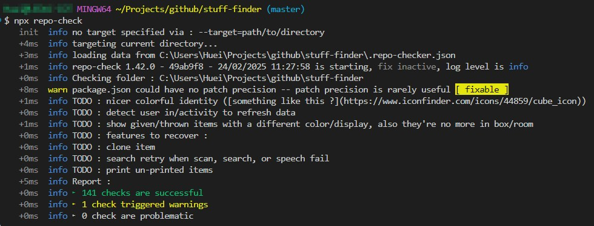

# Repo Checker

[](https://github.com/Shuunen/repo-checker/blob/master/LICENSE)
[](https://codeclimate.com/github/Shuunen/repo-checker)
[](https://www.npmjs.com/package/repo-check)
[](https://www.npmjs.com/package/repo-check)

[](https://packagequality.com/#?package=repo-check)
[](https://bundlephobia.com/package/repo-check)
[](https://packagephobia.com/result?p=repo-check)



- [Repo Checker](#repo-checker)
  - [Demo](#demo)
  - [Usage](#usage)
  - [Options](#options)
  - [Configuration](#configuration)
  - [Todo](#todo)
  - [Thanks](#thanks)
  - [Page views](#page-views)

## Demo



## Usage

Run it in a folder of projects to check them all against your GitHub account, or inside one project to check only that one. It needs `git` and an authenticated [GitHub CLI](https://cli.github.com) (`gh auth login`), and changes nothing: it only reports.

```bash
npx repo-check
```

From a clone of this repository: `bun install` then `bun scan --target=~/Projects`.

`npx repo-check ui` (or `bun ui` from a clone) starts a local server on `127.0.0.1:4747` instead. Open the printed URL: the project list fills in as the scan streams, with filters, summary tiles and a Rescan button, and a click on a project opens its findings and git state. Run inside one project, it opens straight on that project. It can clone a repo you do not have yet, and delete the local clone of an archived repo that holds nothing that is not on GitHub, each after a confirmation. The other fixes (unarchive and push, discard, delete a fork) are not built yet.

The report groups the findings by severity (errors, warnings, info) and ends with a summary line. It exits with an error code when a finding is an error. Every check is listed in [docs/checks.md](docs/checks.md).

## Options

- `--target=path` folder to scan, the current one by default
- `--owner=name` GitHub account to compare with, the `gh` login by default
- `--no-fetch` skip `git fetch`, faster but unpushed work is measured against stale remote refs
- `--verbose` also list every passed and skipped check, per project
- `--port=number` port of the `ui` server, 4747 by default

## Configuration

A `.repo-checker.json` file in a project tells repo-check what it cannot detect, for example:

```json
{
  "license": "MIT",
  "maxSizeKo": 100,
  "webUrl": "https://my-website.com"
}
```

## Todo

- [ ] if website : check static folder : should have "_headers" & "favicon.ico" and "manifest.json" files inside
- [ ] compute build/dist/folder/public size for maxSize compliance
- [ ] check `rel="noopener"` or `rel="noreferrer"` to any `<a` external links to improve performance and prevent security vulnerabilities
- [ ] check `width` and `height` attributes to any `<img` or `<video` to ensures that the browser can allocate the correct amount of space in the document
- [ ] suggest lighthouse budget like [3f052df](https://github.com/Shuunen/stuff-finder/commit/3f052df076b23503d3692883319c618c2d045a99) & [1c4c2f3](https://github.com/Shuunen/stuff-finder/commit/1c4c2f365bc53ba158d7e4eeda596094cad8accb) add appropriate thanks to [lighthouse-ci-action](https://github.com/treosh/lighthouse-ci-action) & lighthouse
- [ ] enhance readme headers via snippets/banner or [socialify.git.ci](https://socialify.git.ci/Shuunen/repo-checker?font=Inter&language=1&owner=1&pattern=Circuit%20Board&stargazers=1&theme=Light) or [satori](https://github.com/vercel/satori)

## Thanks

- [Boxy Svg](https://boxy-svg.com) : simple & effective svg editor
- [Bun](https://bun.sh) : super fast runtime for JavaScript and TypeScript
- [Dependency-cruiser](https://github.com/sverweij/dependency-cruiser) : handy tool to validate and visualize dependencies
- [Github](https://github.com) : for all their great work year after year, pushing OSS forward
- [Knip](https://github.com/webpro/knip) : super tool to find & fix problems
- [Oxc](https://oxc.rs) : a lovely super-fast collection of JavaScript tools written in Rust
- [Repo-checker](https://github.com/Shuunen/repo-checker) : eslint cover /src code and this tool the rest ^^
- [Shields.io](https://shields.io) : for the nice badges on top of this readme
- [Svg Omg](https://jakearchibald.github.io/svgomg) : the great king of svg file size reduction
- [V8](https://github.com/demurgos/v8-coverage) : simple & effective cli for code coverage
- [Vitest](https://github.com/vitest-dev/vitest) : super fast vite-native testing framework

## Page views


