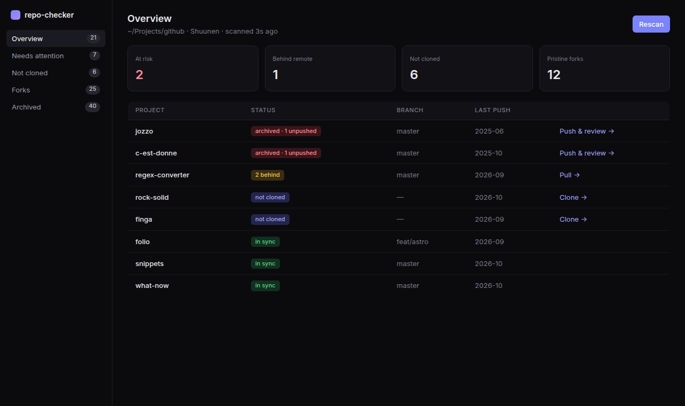
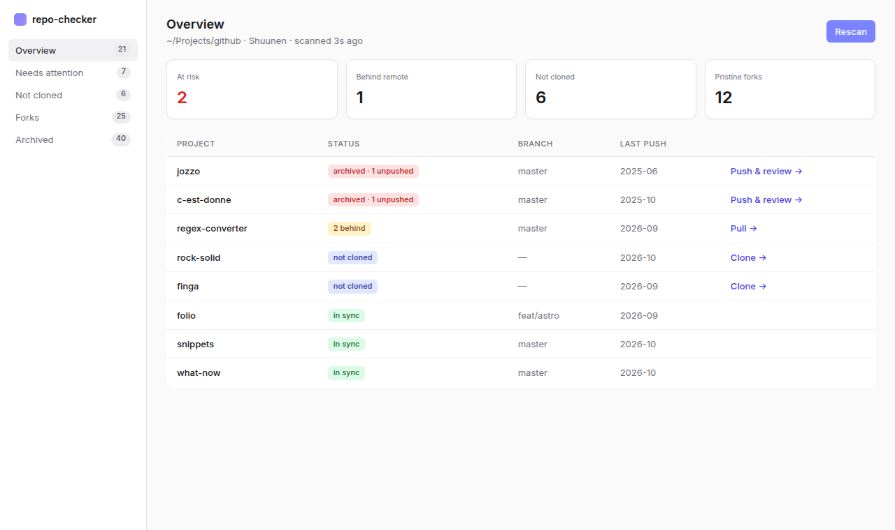

# UI

Status: the project list is built (read only, its action buttons are disabled), the project view and the dialogs are proposed.

## Library and theme

- **HeroUI v3** (installed package) on React 19 and Tailwind 4. Custom pieces use plain Tailwind classes.
- Look: calm and modern. Neutral palette, small text, subtle borders, understated motion.
- Light and dark themes, following the OS setting. The "At risk" color stays clearly red in both.
- HeroUI v3 requires React 19 and Tailwind 4. Its animations are CSS based (data attributes such as `data-entering` and `data-exiting`, `tw-animate-css`) and respect `prefers-reduced-motion`. `motion` can be added for custom effects.

## Mockups

These sketches show the intended feel with real data. They are drawings, not HeroUI output. They also show "behind" and "uncommitted" statuses, which are the `behind-remote` and `uncommitted-files` checks and are not in v1.

The built tiles are At risk (Sync errors), With file errors, Not cloned and Pristine forks. "Behind remote" comes with its check.

Dark: 

Light: 

## Screens

### Project list (folder mode)

- Header: target folder, owner, time of the last scan, a Rescan button.
- Summary tiles: at risk, not cloned, cleanup (archived clones and pristine forks).
- Table, one row per project: name, status pills, branch, last push, one primary action.
- Rows arrive live while the scan runs. A row for a project still being checked shows a loading state.
- Sidebar filters with counts: overview, needs attention, not cloned, forks, archived.
- Clicking a row opens the project view.

### Project view (single-project mode opens here directly)

- Identity: name, GitHub link, owner, archived and fork badges, last push.
- Group A findings for this project, each with its explanation in plain words.
- Local state used for safety decisions: branch, ahead and behind, uncommitted files, stash, local-only branches.
- Actions: only the ones that apply, each opens a confirm dialog that restates what will happen and what cannot be undone.
- When a delete is not offered, say why (for example "1 unpushed commit").
- The confirm dialog for deleting a local clone lists the gitignored files that will be lost (for example `.env`), leaving out rebuildable folders such as `node_modules` and `dist`.
- Archived repo with unsaved work: a dialog lists the commits, files, stash entries and local-only branches, then offers "Unarchive, push, re-archive" or "Discard". Each states what it changes and what cannot be undone. "Unarchive, push, re-archive" is disabled, with the reason, while uncommitted files, untracked files or a stash exist.
- Fork rows show why they are or are not offered: "pristine", "has commits ahead", "open PR", "local clone has unsaved work", or "cannot verify". When a pristine fork has a clean local clone, the confirm dialog says both will be deleted.
- Local folders that are not usable repos show the reason and the path, with no action.

## States to design for

Loading, empty (everything is in sync), error (`gh` missing or not logged in, no network), partial (some projects failed to scan), missing `delete_repo` scope.

## Open points

- Empty-state wording and any personality (butler or garden touches) are undecided.
- Charts are not in v1. If wanted later, add a small chart library, HeroUI has none.
